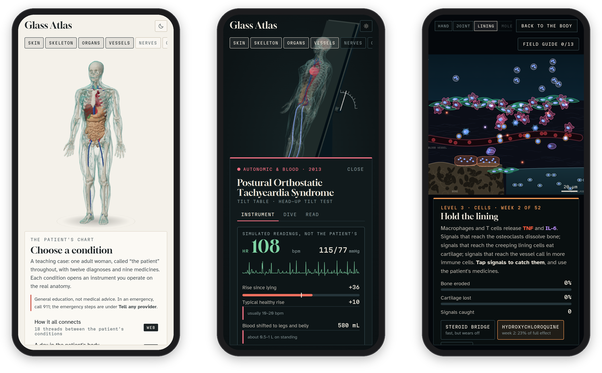
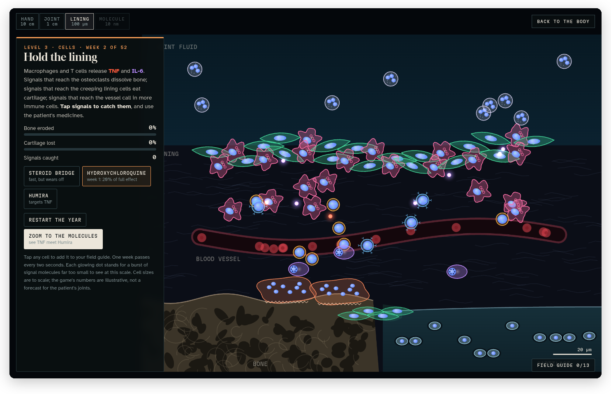
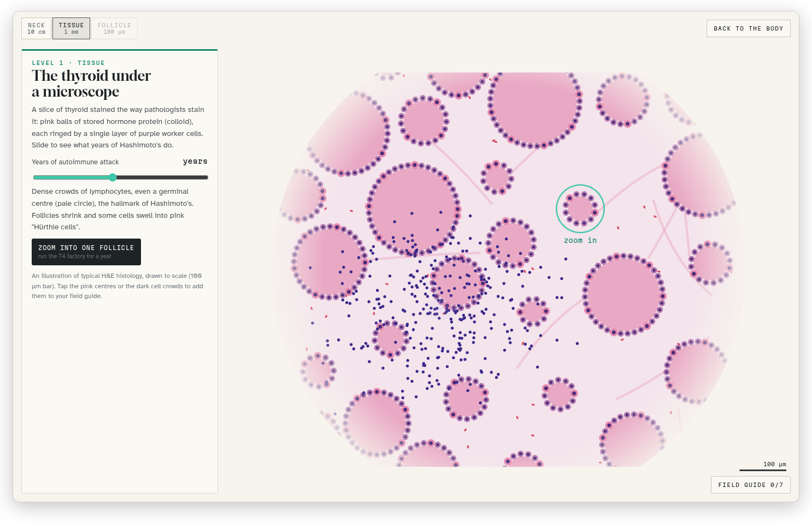
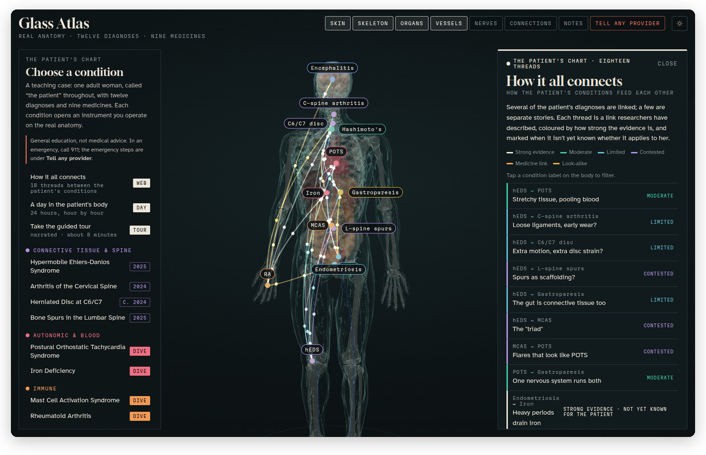
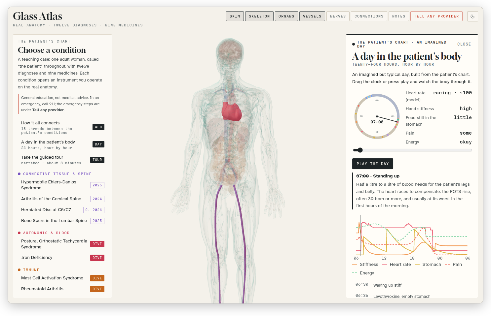
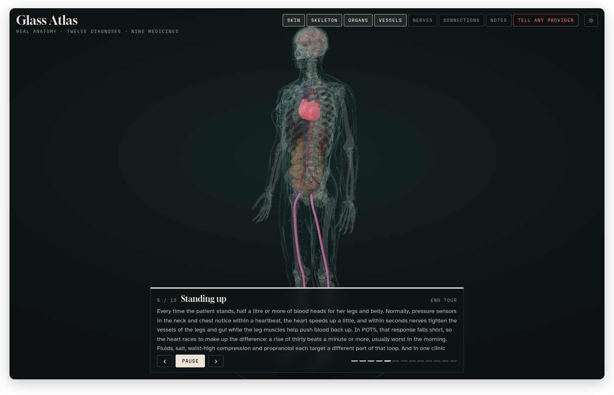
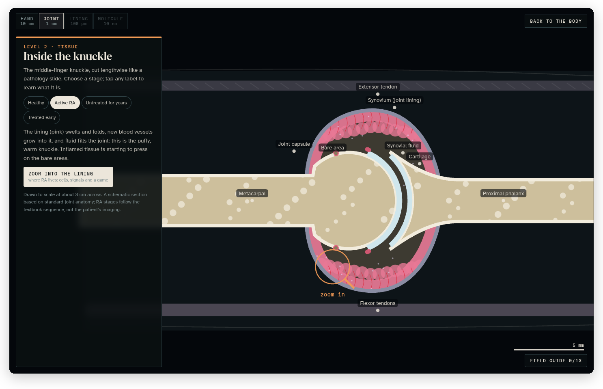
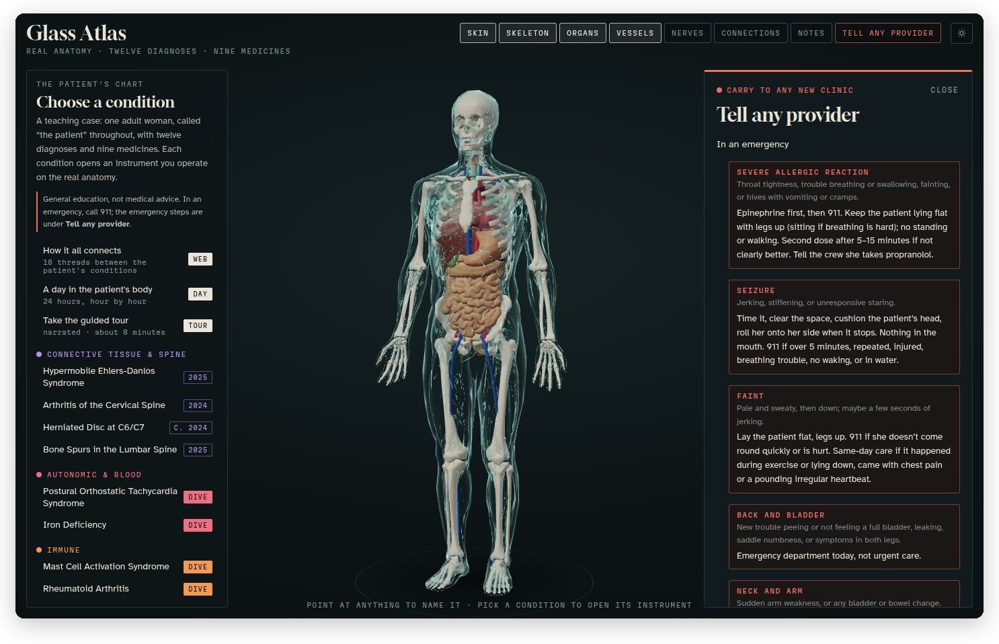

<h1 align="center">Glass Atlas</h1>
<p align="center"><b>An interactive 3D atlas of real human anatomy, built around one teaching case.</b><br>Twelve diagnoses and nine medicines, each one something you operate on the body, in the browser, in dark or light.</p>
<p align="center">
  
  
  
  
  
  
</p>
<p align="center">
  <a href="#try-it"><b>Try it</b></a> ·
  <a href="docs/README.md"><b>Docs</b></a> ·
  <a href="#features">Features</a> ·
  <a href="#screenshots">Screenshots</a> ·
  <a href="docs/DEVELOPING.md">Run it yourself</a>
</p>

<picture>
  <source media="(prefers-color-scheme: dark)" srcset="docs/images/hero-dark.png">
  
</picture>

> General education, not medical advice. The patient is a teaching case, the models and games are labelled as illustrative where they are, and in real care a patient's own clinicians decide.

## Why I made it

Most anatomy apps show you a body, and most case studies are a few pages of text. I wanted to see what happens when you put the two together: ONE case, followed through real anatomy, where every condition is something you operate instead of a paragraph you read. So Glass Atlas has a tilt table that stands the body up and shows the heart racing, a hand that opens as the morning stiffness wears off, and a microscope that zooms from the knuckle all the way down to the molecule a medicine catches.

The case is a teaching case: an adult woman, called "the patient" throughout, with twelve diagnoses and nine medicines. That sounds like a lot, and it is, but the interesting part is how they touch each other: why the iron matters for the heart rate, why the thyroid pill and the iron tablet need four hours apart, which links between the conditions are proven and which aren't yet. The connections web, the day view and the medicines planner are all about that. Every clinical claim has a source you can click.

It's for anyone learning how the body works and how conditions affect each other, like students in nursing, medicine and the other health sciences, and for anyone who'd rather move a slider than read a paragraph. You don't need to know any medicine to start: the tour walks you through the whole case in about eight minutes.

## Features

### The body

- **Real anatomy.** Bones, organs, vessels, nerves and skin from the BodyParts3D research database, which you turn, zoom and point at to have any part named, along with the conditions that involve it.
- **Layers.** Skin, Skeleton, Organs, Vessels and Nerves, each on and off with one button.
- **Light and dark.** It follows your system until you pick one. In light mode the microscope switches from darkfield to brightfield, and the stained slides keep their real stain colours.

### The case

- **Twelve diagnoses and one suspected**, grouped by body system, from POTS and hypermobile Ehlers-Danlos to Hashimoto's, rheumatoid arthritis and gastroparesis.
- **An instrument for each.** A tilt table, a Beighton bench on the real skeleton, a thyroid loop, a gastric-emptying scan, a cervical spine you tip back until the nerve is pinched, a colposcope view, and more, all operated with sliders and switches while the body moves beside them.
- **A reading for each.** One plain sentence first, then the details, a red **For any provider** box where something matters in an emergency, and the sources.

### Going deeper

- **Five dives.** A microscope from the body down to the tissue, the cells and the molecules, for rheumatoid arthritis, Hashimoto's, mast cells, POTS and iron, each with a small game: hold the joint lining for a year, run a thyroid follicle, keep a mast cell calm.
- **The field guide.** Every cell and molecule you tap gets a card, and **Quiz me** tests you on them.

### The whole picture

- **Medicines.** All nine, with a search box, a page each, and a planner for the patient's day that checks the spacing as you drag the times and shows where the medicines add up (heart rhythm, blood pressure, seizure threshold, serotonin and more).
- **How it all connects.** Eighteen threads between the conditions, drawn on the body and coloured by how strong the evidence is.
- **A day in the patient's body.** Twenty-four hours you scrub through or play, from waking up stiff to protecting sleep.
- **The guided tour.** Thirteen narrated stops, about eight minutes, with the camera and the highlights following along.
- **Tell any provider.** An emergency card with five emergencies and the handful of facts that change what a stranger in scrubs should do.
- **Notes on the body.** Tap a spot and pin a note there, kept in your browser.
- **Sources and review.** 87 references, each one a click away from the reading that cites it.

### Anywhere

- **Phone or computer.** On a phone the case moves to the bottom and the drawer slides up under the body.
- **Offline and self-contained.** Static files with three.js and the fonts bundled: no CDNs, trackers or analytics, and nothing to install.

## Screenshots

<p align="center"></p>


*POTS on the tilt table, three minutes into the test: the heart rate on the monitor, the rise since lying down, and the blood that has shifted to the legs.*


*The rheumatoid arthritis dive, in the joint lining: catch TNF and IL-6 and use the patient's medicines to protect the bone for a year.*


*A stained thyroid slide in light mode, the way a pathologist sees it, with years of Hashimoto's on the slider.*


*The patient's day, hour by hour: the medicines, the meals, and the spacing checks.*

<details><summary>More screenshots</summary>


*How it all connects: the threads between the conditions, coloured by the strength of the evidence.*


*A day in the patient's body at seven in the morning, standing up, with the heart lit and the readouts for that hour.*


*The guided tour at stop 5 of 13, standing up.*


*The cervical spine: the C6/C7 disc, the head tipped back, and the C7 root under pressure.*


*Rheumatoid arthritis, Read tab: the plain sentence, the For any provider box, and what it is.*


*Inside the knuckle, in the "Active RA" stage.*


*The medicines list searched for "as needed", with Zofran open.*


*Tell any provider, starting with what to do in an emergency.*


*The skin and organs off and the nerves on, seen from behind, with the first lumbar vertebra named under the pointer.*

</details>

## Try it

Glass Atlas is live at <https://stuffs.tiresia.xyz/body-atlas-1/>. It runs in any current browser with nothing to install, and the few things it remembers (your theme, your notes and your field guide) stay in that browser.

The quickest way in is the tour: press **Take the guided tour** on the left and let it run. Then open any condition, and if it has a **Dive** badge, go down the microscope.

### Run it yourself

It's a static app, so any web server will do. From the `app/` folder:

```sh
python3 -m http.server 8000
```

Then open <http://localhost:8000/index.html>. It needs to be served over HTTP rather than opened as a file, since it loads its modules and data with `fetch`. The rest, including a map of the code and the check that walks every screen, is in [Developing Glass Atlas](docs/DEVELOPING.md).

## Documentation

The docs walk through every part of the atlas the way I'd show it to you sitting next to me.

- **Getting started:** [What is Glass Atlas?](docs/what-is-glass-atlas.md)
- **Using the atlas:** [The 3D body](docs/the-body.md), [The case and its instruments](docs/the-case.md), [The dives](docs/dives.md), [Medicines](docs/medicines.md), [Connections, the day and the tour](docs/connections-day-tour.md), [The emergency card, notes and sources](docs/emergency-notes-sources.md)
- **Under the hood:** [Developing Glass Atlas](docs/DEVELOPING.md), [The references](research/references.md), [The notes folder](notes/README.md)

Start with [What is Glass Atlas?](docs/what-is-glass-atlas.md)

## How it's built

- **The app** is static: `app/index.html` and plain ES modules, with no build step, and three.js and the fonts bundled in `app/vendor/`.
- **The anatomy** is BodyParts3D, decimated, adapted and packed into one file by the scripts in `build-pipeline/`, and unpacked in the browser.
- **The instruments** are three.js on the body plus 2D canvas and SVG in the drawer, and the dives are 2D canvas scenes drawn to scale.
- **Light and dark** come from `app/theme.js`, which swaps the colour tokens and remaps every 2D canvas, so the drawing code doesn't need to know which theme is on.
- **The narration** for the tour was generated with Piper TTS.
- **The check**, `tools/check.py`, walks every screen in light and dark in headless Chrome and fails on any page error.

## Credits and licenses

- **Code and text:** MIT license, see [`LICENSE`](LICENSE). That covers everything here except the items below, which keep their own licenses ([`NOTICE`](NOTICE) says the same in short).
- **Anatomy:** BodyParts3D, © 2008 Life Science Integrated Database Center, licensed under CC BY-SA 2.1 Japan (Mitsuhashi et al., Nucleic Acids Res 2009), via K. Moerman's repository. The meshes in `app/anatomy.txt` are decimated and adapted derivatives, so they carry the same license: share-alike with attribution. <https://creativecommons.org/licenses/by-sa/2.1/jp/deed.en>
- **three.js** r160: MIT license, `app/vendor/three/LICENSE`.
- **Fonts:** Gloock, Atkinson Hyperlegible and Martian Mono, SIL Open Font License 1.1, `app/vendor/fonts/OFL-*.txt`.
- **Narration:** generated with Piper TTS using the en_US-lessac-high voice. Check that voice's model card for its license terms before redistributing the audio.
- **Content:** written with Claude and reviewed by five AI reviewers (not physicians) against guidelines, FDA labels and primary studies, October 2026. The review reports themselves aren't included here.
