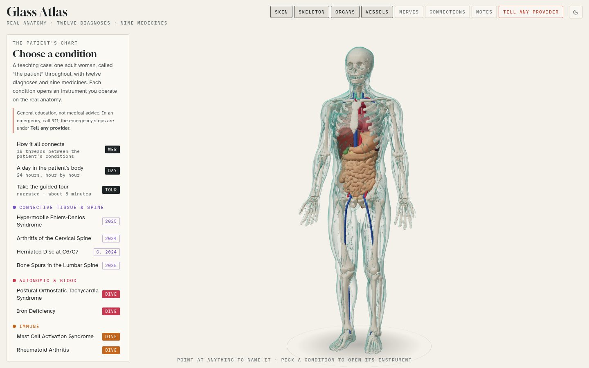

# Glass Atlas

An interactive 3D atlas of real human anatomy that walks through one teaching case: an adult female patient with twelve diagnoses and nine medicines. Each condition opens an instrument you operate on the anatomy; five conditions also have a "dive" down to cells and molecules. There is a connections web, a 24-hour day view, a medicines planner, a narrated tour (about 8 minutes), an emergency card, and a sources panel with 87 references.

General education, not medical advice.

**Try it:** <https://stuffs.tiresia.xyz/body-atlas-1/>

It comes in a dark mode and a light mode. It follows your system setting until you pick one with the sun/moon button in the top bar. In light mode the microscope dives switch from darkfield to brightfield, and the stained slides keep their real stain colours.

Exported 13 October 2026 from version 12 of the published artifact; light mode added 17 October 2026.



## What's in this folder

| Folder | Contents |
|---|---|
| `app/` | The complete app. `index.html` is a self-contained, fully offline copy (three.js and fonts are bundled in `vendor/`). `atlas.html` is the source exactly as published to claude.ai (dark only, before light mode), which loads three.js from a CDN. |
| `app/tour/` | Narration audio for the 13 tour stops (MP3), and `tour-script.json` holds the text and camera positions. |
| `app/anatomy.txt` | The anatomy meshes, gzip-compressed and base64-encoded; decoded in `core.js`. |
| `research/references.md` | All 87 references, with links. |
| `research/model-checks/` | Node scripts used to check the iron, thyroid, hand and gastric-emptying models against published data. |
| `build-pipeline/` | Python scripts and manifests that turned BodyParts3D STL files into `anatomy.txt` (decimate, adapt the skin surface, pack). The raw BodyParts3D download (~500 MB) isn't included; the scripts expect it at `bp3d/assets/BodyParts3D_data/stl/`. |
| `tools/` | Headless-browser screenshot and test scripts (Playwright) and the Piper text-to-speech script used for the narration. Paths inside them point at the original build machine and need adjusting. |
| `notes/` | Export of the app's shared notes (empty) and where local notes live. |
| `screenshots/` | Screens from the offline copy, dark and light. |

## Running it

The app uses ES modules and loads its data with `fetch`, so it needs to be served over HTTP rather than opened as a file. From the `app/` folder:

```
python3 -m http.server 8000
```

Then open <http://localhost:8000/index.html>. Any static web server works (Caddy, nginx, etc.), so it can sit on a homelab box as-is.

Notes in the self-hosted copy are saved to the browser only (see `notes/README.md`); the shared notes database and viewer names exist only in the claude.ai version.

## Files in `app/`

- `core.js`: renderer, camera, anatomy loading, picking
- `data.js`: conditions, medicines, alerts, emergency cards
- `refs.js`: the references
- `stations.js` – `stations4.js`: the instruments (tilt table, Beighton, neck, hand, stomach, thyroid, MCAS, iron, seizure threshold, lumbar, cervix, endometriosis, medicines planner)
- `dive.js` and `dive-*.js`: the cell- and molecule-level dives and the field guide
- `web.js`, `day.js`, `notes.js`, `tour.js`, `kit.js`: connections, the day view, notes, the tour, shared helpers
- `theme.js`: light and dark. CSS tokens for the panels, `light-dark()` pairs for inline colours, and a remap for every 2D canvas (lightness turned over in OKLCH, hue kept), so the drawing code doesn't need to know which theme is on

## Credits and licenses

- **Code and text:** MIT license, see [`LICENSE`](LICENSE). That covers everything here except the items below, which keep their own licenses.
- **Anatomy:** BodyParts3D, © 2008 Life Science Integrated Database Center, licensed under CC BY-SA 2.1 Japan (Mitsuhashi et al., Nucleic Acids Res 2009), via K. Moerman's repository. The meshes in `app/anatomy.txt` are decimated and adapted derivatives, so they carry the same license: share-alike with attribution. <https://creativecommons.org/licenses/by-sa/2.1/jp/deed.en>
- **three.js** r160: MIT license, `app/vendor/three/LICENSE`.
- **Fonts:** Gloock, Atkinson Hyperlegible and Martian Mono, SIL Open Font License 1.1, `app/vendor/fonts/OFL-*.txt`.
- **Narration:** generated with Piper TTS using the en_US-lessac-high voice. Check that voice's model card for its license terms before redistributing the audio.
- **Content:** written with Claude and reviewed by five AI reviewers (not physicians) against guidelines, FDA labels and primary studies, October 2026. The review reports themselves aren't included here.
