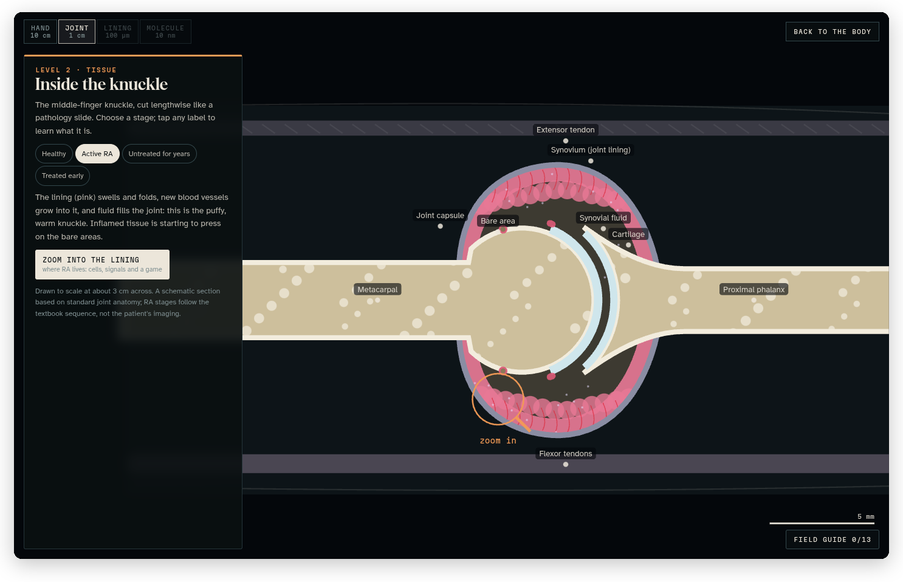
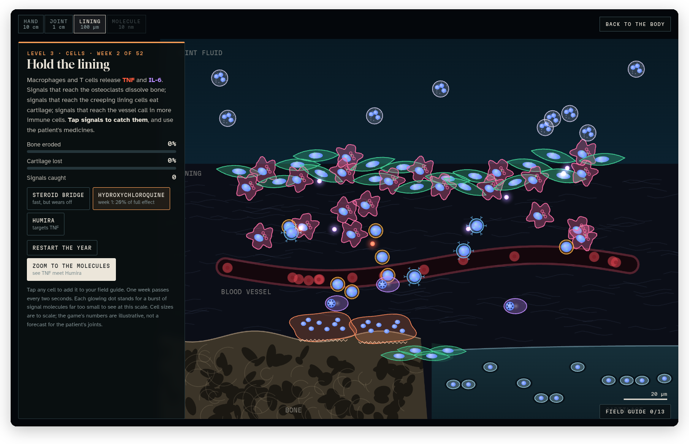
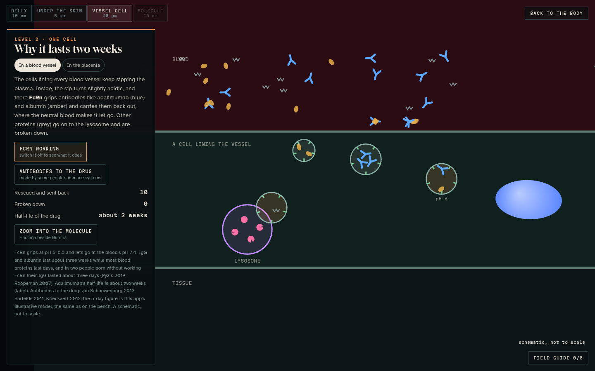
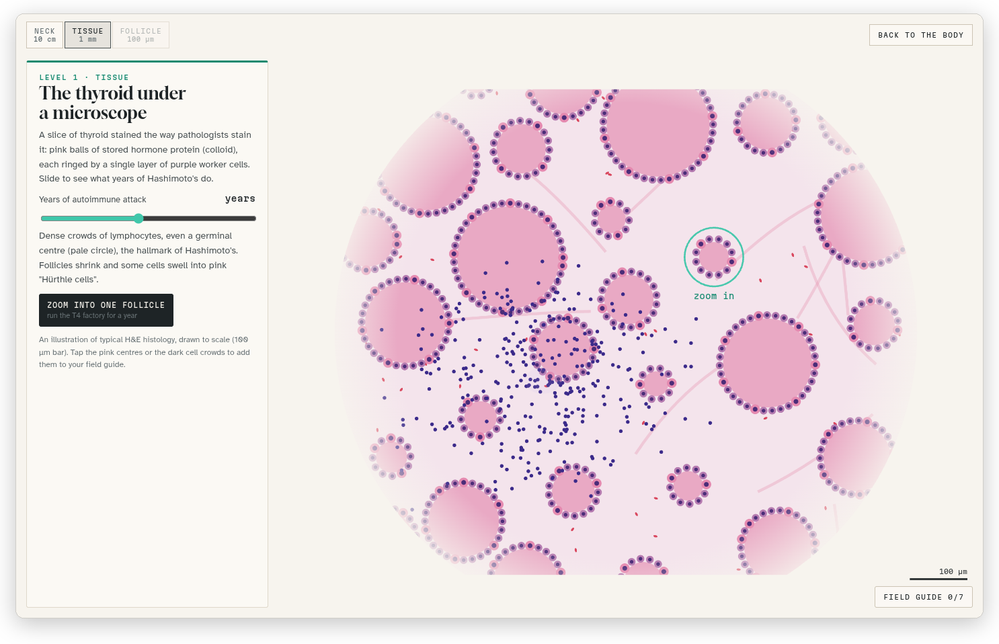

[Glass Atlas docs](README.md) › Using the atlas

# The dives

A dive is a microscope that zooms from the body down into one part of it: first the tissue, then the cells, and often the molecules. Five conditions have one, and they're the ones with a **Dive** badge in the case: Rheumatoid Arthritis, Hashimoto's Disease, Mast Cell Activation Syndrome, POTS and Iron Deficiency. Each of the patient's ten medicines has one too, which follows the medicine to where it works (see [The medicine dives](#the-medicine-dives) below).

*Inside the knuckle: the middle-finger joint cut lengthwise like a pathology slide, in the "Active RA" stage.*

## Starting one

Open a condition with a dive, or any medicine, go to its **Dive** tab, which lists the levels and what you'll do at each one, and press **Start the dive**. The camera flies to the spot on the body first (the knuckle, the thyroid, the forearm, the neck or the duodenum for the conditions, and the belly, the eye, the heart or the brainstem for some of the medicines), and then the microscope opens over it.

## Finding your way

Along the top are the levels as a scale, from the body part you started on down to the smallest level, each with its size ("Joint, 1 cm", "Lining, 100 µm", "Molecule, 10 nm"). You go deeper with the button at the bottom of the card on the left ("Zoom into the lining" and so on), and each level you've reached stays open in the scale, so you can click back to it. The first one, the body part you started on, takes you back out. The card says where you are and what you're looking at, and some levels have stages to compare, like "Healthy", "Active RA", "Untreated for years" and "Treated early".

**Back to the body**, at the top right, closes the microscope and takes you back to the condition or the medicine you started from. **Escape** does the same.

## The five dives

| Dive | The levels | What you do |
|---|---|---|
| **Rheumatoid Arthritis** | The hand, the joint (1 cm), the lining (100 µm), the molecules (10 nm) | Compare a healthy knuckle with active RA, years untreated and treated early. Then, in the lining, catch TNF and IL-6 and use the patient's medicines to protect the bone and cartilage for a year. At the bottom, the patient's Hadlima (adalimumab) catches TNF and hydroxychloroquine sits in the lysosome. |
| **Hashimoto's Disease** | The neck, the tissue (1 mm), one follicle (100 µm) | Look at a stained slide the way a pathologist does, healthy follicles and then years of Hashimoto's. Then run one follicle, the tiny hormone factory, for a year: adjust the levothyroxine, check the labs, and live with TSH's six-week lag. |
| **Mast Cell Activation Syndrome** | The forearm, the skin (1 mm), one mast cell (20 µm) | Watch histamine make a red spot, a spreading flare, a hive and the itch, and what an antihistamine changes. Then shrink to one mast cell and keep it calm while triggers drift in, and see where cromolyn and the H1 and H2 blockers each act. |
| **POTS** | The neck, the reflex circuit (1 m), the rhythm game | Follow the reflex that keeps blood in the head when the patient stands, and the four ways it can fall short. Then play it: every heartbeat you catch on time fires a squeeze, ten minutes upright in sixty seconds, with compression, fluids and propranolol to try. |
| **Iron Deficiency** | The gut, the lining (1 mm), one gut cell | See the villi that absorb iron, then dose one gut cell daily or every other day for two weeks, and see why hepcidin, the lock on the cell's one exit door, changes the math, and what orange juice or coffee do. |

*The lining game: the cells to scale, the signals to catch, and the patient's medicines as buttons, with the bone and cartilage counters on the card.*

The biology is drawn from published reviews, guidelines and medicine labels. The games' numbers are illustrative, and the card says so where a drawing is schematic and not to scale.

## The medicine dives

Each medicine's page has a **Dive** tab beside **Instrument** and **Read**. It lists the levels, has **Start the dive**, and ends with the dive's sources. Some of them also have buttons straight into a condition dive at the level where the medicine shows up there, such as Hadlima catching TNF in the rheumatoid arthritis dive, and "Back to the body" then brings you back to the medicine. The other way round, a condition's **Dive** tab lists the medicine dives for the medicines that treat it.

*The Hadlima dive, one level down: the cell lining a blood vessel, where the receptor FcRn rescues the antibody and sends it back to the blood.*

| Medicine | The levels | What you do |
|---|---|---|
| **Hadlima** | The belly, under the skin (5 mm), one vessel cell (20 µm), the molecule (10 nm) | Inject a dose and watch fourteen days as it seeps into the lymph and peaks in the blood after five and a half days. In a cell lining a vessel, see the receptor that keeps it in the blood for two weeks, what antibodies to the drug do, and the same receptor carrying it across the placenta. Then the antibody itself: its parts, Hadlima beside Humira from the lab comparison, and catching TNF, with a door into the knuckle. |
| **Hydroxychloroquine** | The eye, a year of build-up, the retina (a 30° scan) | Take daily tablets and watch a year as they fill the tissues; miss a dose, miss a week, or stop. Then an OCT scan beside a photo of the back of the eye: move the scan, step through the stages of toxicity, and see how the exams and the risk change with years and dose. |
| **Propranolol XR** | The heart, the pacemaker (0.5 mm), the receptor (10 nm) | Stand the patient up and compare no propranolol with the low and high doses of the 2009 POTS study. Then beta-1 and beta-2 receptors with propranolol in them, through standing, low blood sugar, epinephrine and glucagon. |
| **Tizanidine** | The neck, the spinal cord (1 cm), one synapse (1 µm), the liver enzyme | Set off a spasm, take a dose and watch eight hours. The alpha-2 brake on a nerve ending and its blood-pressure side. Then CYP1A2 in the liver, jammed by the pill, ciprofloxacin or fluvoxamine, with the measured rises. |
| **Lexapro** | The brainstem, a synapse (1 µm), the SERT pump (10 nm) | Step through six weeks at one serotonin synapse. Lock pumps with escitalopram, then see the same pump in a platelet, the link to bleeding with ibuprofen. |
| **Ibuprofen** | The stomach, the lining, the COX enzyme (10 nm) | Take doses with and without food and watch the prostaglandin shield thin, and what Lexapro adds when a raw spot bleeds. Then ibuprofen sitting in the COX-1 and COX-2 channels, and what it doesn't touch in RA. |
| **Adderall XR** | The brain, the capsule (2 cm), one nerve ending (1 µm) | The capsule's two waves of beads over a day, and what's left at lights-out. Then amphetamine riding in through the transporter and turning the pump around, in the brain and in the nerves to the heart, with propranolol. |
| **Low-dose naltrexone** | The neck, the pain relay in the spinal cord, opioid receptors (10 nm) | The microglia idea (a hypothesis) and what two placebo-controlled trials found. Then a day of receptors after a dose, an opioid painkiller given at different hours, and the rebound idea (also a hypothesis). |
| **Zofran** | The gut, the gut wall (250 µm), the 5-HT3 receptor (10 nm) | Irritate the gut and watch the signal climb the vagus to the brainstem, and what ondansetron changes and doesn't (the slow stomach). Then serotonin and ondansetron competing for the receptor, with the QT and serotonin-syndrome warnings. |
| **Levothyroxine** | The belly, the stomach and gut (20 cm), one cell (20 µm) | Swallow the pill with water, coffee, breakfast, calcium, iron or an antacid, together or spaced, with numbers only where a study measured them. Then T4 becoming T3 inside a cell, and why TSH is read six to eight weeks after a dose change. |

The medicine dives follow the same rules as the others: the sources are on the Dive tab and in the fine print, models are labelled illustrative, and where something is a hypothesis (as with low-dose naltrexone), the card says so.

## The field guide

Every cell and molecule you tap in a dive goes into the "field guide", with a little drawing and a short note on what it is and what it does. The **Field guide** button at the bottom right shows how many you've found out of how many there are in that dive, like "Field guide 4/13", and opens the cards. A card you haven't found yet stays blank until you tap that thing in the microscope.

**Quiz me**, under the cards, shows you one of the drawings and four names to choose from, and keeps the score as you go. Once you've found four or more, it asks about the ones you've found, and a right answer about one you haven't found yet adds it to the guide.

The field guide is kept in your browser, so it's still there the next time, and the **Dive** tab of each condition counts the entries you've collected across all the dives.

*The thyroid dive's stained slide in light mode: the microscope switches to brightfield, and the stain keeps its real colours.*

Next: [Medicines](medicines.md) →
