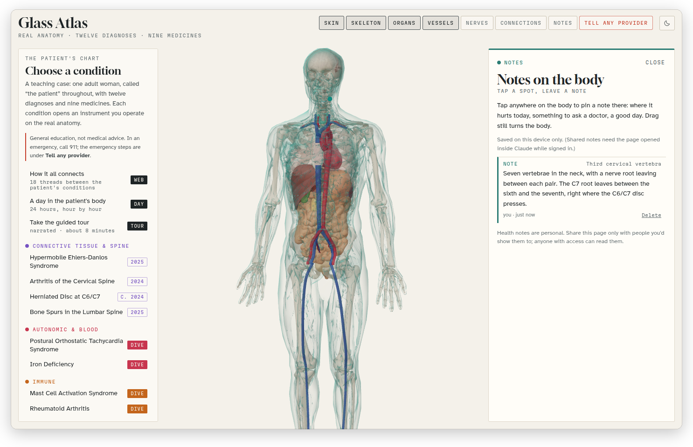
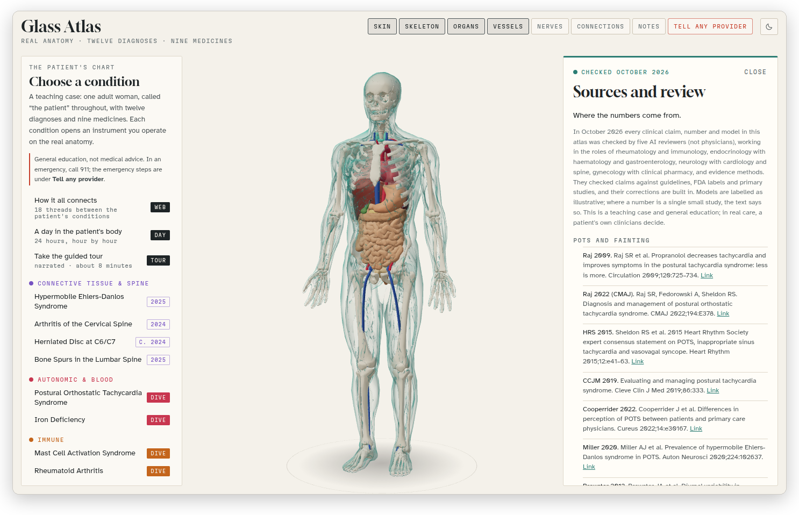

[Glass Atlas docs](README.md) › Using the atlas

# The emergency card, notes and sources

Three things sit on the edges of the atlas and are easy to miss: the red **Tell any provider** button at the top, **Notes** beside it, and **Sources and review** at the bottom of the case. This page is about all three.

## Tell any provider

**Tell any provider** opens the case's emergency card, the page you'd carry to any new clinic. It's in two parts.

The first is "In an emergency": five situations, each with the signs to look for and what to do, in plain words. They are a severe allergic reaction, a seizure, a faint, a back-and-bladder emergency and a neck-and-arm one, and each says when it's 911 and when it's the emergency department today.

The second is "the handful of facts that change what a stranger in scrubs should do": eleven short points about the case, numbered, like which medicines lengthen the QT interval together, which two need four hours apart, why local anaesthetics may work poorly, and what a beta blocker changes about treating a severe allergic reaction. The sources are at the bottom, as everywhere else.

*The emergency card, starting with what to do in an emergency. The facts for any provider follow underneath.*

It's part of the teaching case, so it shows what a good card looks like and why each line is on it. It's general education and not a plan for a real person, and in a real emergency, call 911.

## Notes on the body

**Notes** lets you pin a note to any spot on the body. Tap or click anywhere on the body, and a new note opens with the name of the spot you picked, like "Third cervical vertebra". Choose a kind (a **Note**, a **Question for a doctor**, **Pain** with a level from 0 to 10, or **Better today**), write up to 600 characters, and press **Pin the note**. A small dot in the note's colour stays on the body at that spot, and clicking a note in the list flies the camera back to it. **Delete** removes it. You can still drag to turn the body while Notes is open.

*A study note pinned to the third cervical vertebra, in light mode.*

The notes stay in your browser, on that device only: nothing is sent anywhere, and another browser or another device won't see them. If you clear the site's data, they're gone, so keep anything important somewhere else too.

## Sources and review

**Sources and review**, at the bottom of the case, is where the numbers come from. It lists all 87 references, grouped the way the app is (POTS and fainting, hEDS and MCAS, the stomach and gut, iron, the thyroid and autoimmunity, rheumatoid arthritis, the brain, seizures and the spine, the cervix and endometriosis, medicine labels and interactions, and emergencies and first aid), each with a link to the guideline, label or study.

*Sources and review in light mode, with how the content was checked at the top.*

Every reading in the atlas ends with a "Sources:" line, and clicking one of its names opens this list with that reference highlighted, so you can check any claim in two clicks.

At the top it explains how the content was reviewed. In October 2026 every clinical claim, number and model was checked by five AI reviewers (not physicians), each working in the role of a group of specialties, against guidelines, FDA labels and primary studies, and their corrections are built in. Models are labelled as illustrative, and where a number comes from a single small study, the text says so.

The same references, with their links, are in [research/references.md](../research/references.md) in this repository.

Next: [Developing Glass Atlas](DEVELOPING.md) →
