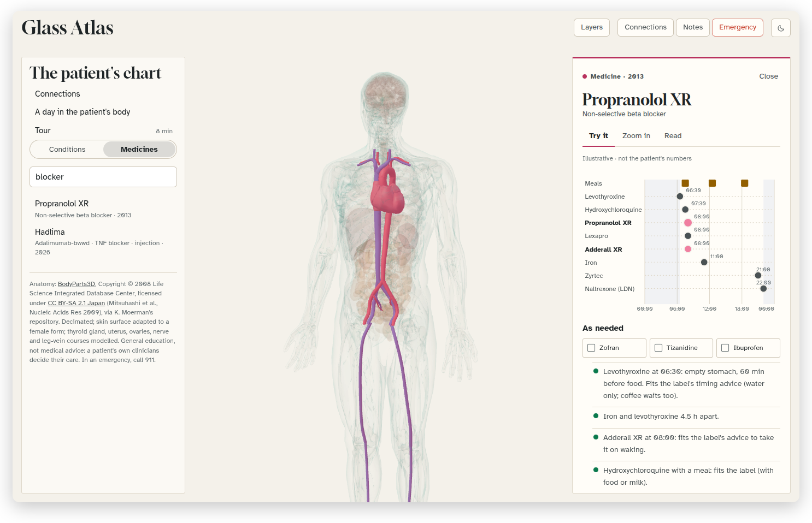
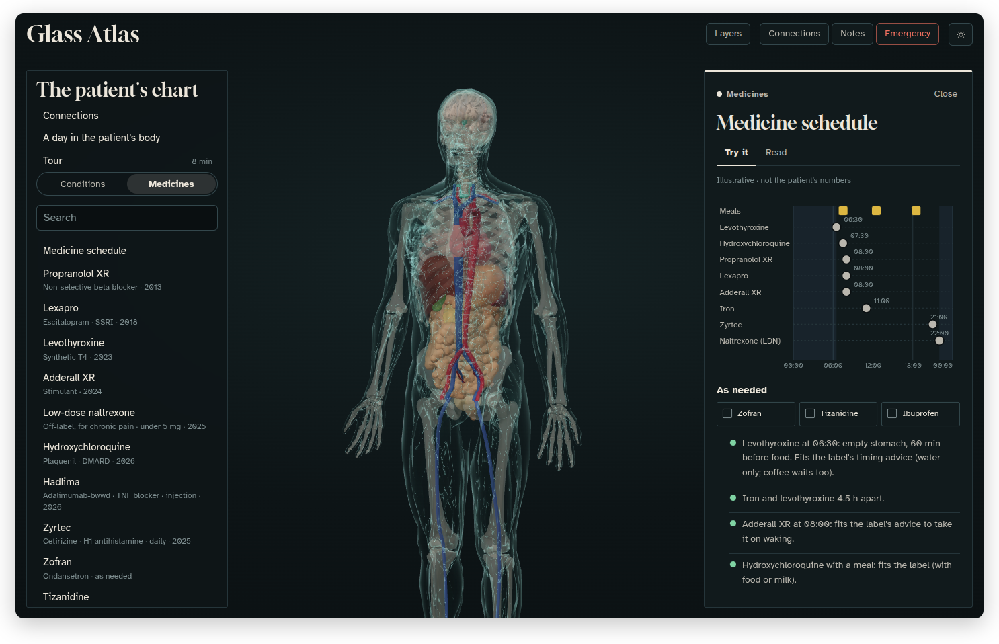
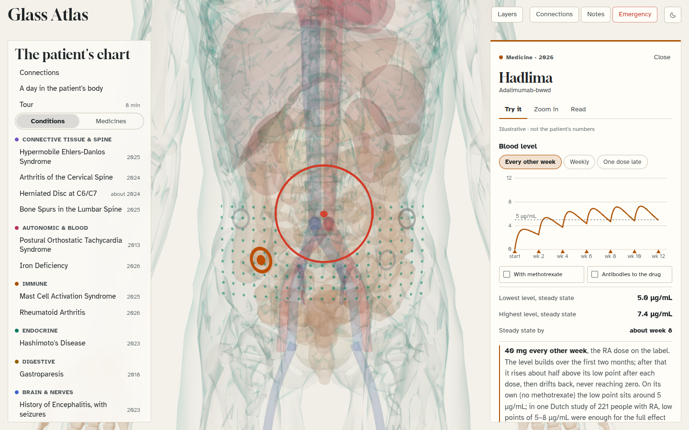
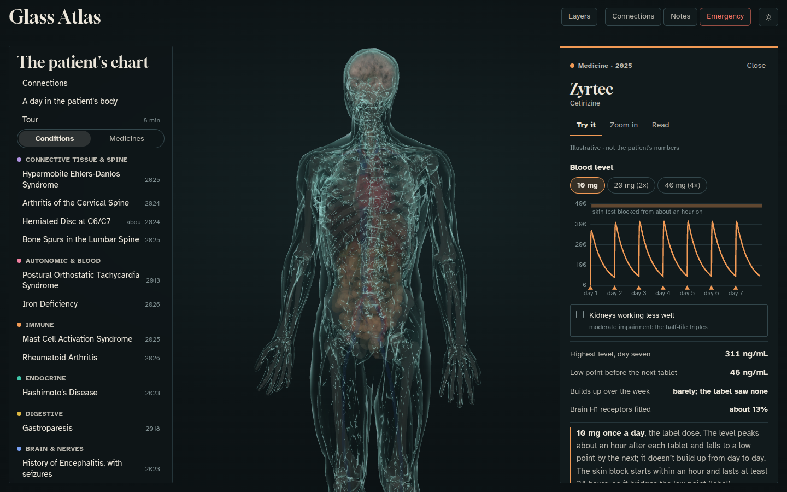

[Glass Atlas docs](README.md) › Using the atlas

# Medicines

The patient takes eleven medicines, and a lot of what matters about them is how they get along: which ones need to be hours apart, which ones pull the heart rate in opposite directions, which ones add up. The medicines part of the atlas is built around that, with a page for each medicine, a schedule for the whole day, and benches of their own for Hadlima, the injection, and Zyrtec, the daily antihistamine.

*The list searched for "blocker", and Propranolol XR open beside it, with the heart and the great vessels lit for the medicines that change blood pressure and pulse.*

## The list

Switch the patient's chart from **Conditions** to **Medicines**, and the list turns into the medicines: first the **Medicine schedule**, then Propranolol XR, Lexapro, Levothyroxine, Adderall XR, Low-dose naltrexone, Hydroxychloroquine, Hadlima, Zyrtec, Zofran, Tizanidine and Ibuprofen, each with what kind of medicine it is and the year it started, or "as needed". **Conditions** switches back.

The **Search** box above the list filters it as you type, by the name or by the kind, so "Zofran", "SSRI" or "blocker" all work. **Escape** clears it.

## One medicine

Click a medicine and the drawer opens with three tabs. **Try it** is the medicine schedule, with that medicine picked out and the body lit where it acts. **Zoom in** goes from the body down to where the medicine works, cells and molecules included (see [The dives](dives.md#the-medicine-dives)). **Read** says what it does in plain words, with a red **For any provider** box where something matters in an emergency, the condition it treats under **What it treats** (click it to go there, and a button like **‹ Zofran** at the top brings you back), and the sources. A medicine also shows up as a link at the bottom of the condition it treats.

## The medicine schedule

*The medicine schedule, the patient's day hour by hour: the meals along the top, a dot for each medicine, the as-needed ones to tick, and the checks underneath.*

The first row of the list, **Medicine schedule**, opens the schedule for all of them together. It starts with "Illustrative · not the patient's numbers", and then it's a 24-hour chart: the meals along the top, and a dot for each medicine at the time it's taken. Drag the dots to try a different schedule (or, with the keyboard, move one with the arrow keys), and the checks underneath update as you go, in green when a timing fits the label's advice and in red or amber when it doesn't. For example, levothyroxine wants an empty stomach 30 to 60 minutes before food, iron and levothyroxine need four hours apart, and hydroxychloroquine goes with a meal.

The three as-needed medicines (Zofran, Tizanidine and Ibuprofen) are off until you tick them under **As needed**, and then they get a row and their own checks.

Under the checks, **Overlaps** has a button for each way they add up: **Timing**, **Heart rhythm (QT)**, **Blood pressure and pulse**, **Seizure threshold**, **Pain relief in an emergency**, **Stomach and absorption**, **Drowsiness** and **Serotonin**. Timing is the plain schedule, and each of the others lights up the part of the body involved, picks out the medicines that share it, and says in a paragraph what to watch for.

The times are a starting template, not a real schedule, and none of it is a dosing plan. The spacing rules come from the medicines' labels, and the sources are on the **Read** tab.

## Hadlima

*Hadlima's bench: the level in the blood over twelve weeks, and the injection sites on the real skin.*

Hadlima is adalimumab-bwwd, a biosimilar of Humira for the patient's RA, injected every other week. A medicine taken every two weeks doesn't fit a 24-hour schedule, so its **Try it** tab is a bench of its own instead, starting with "Illustrative · not the patient's numbers".

**Blood level** is a chart of twelve weeks, built from the numbers on its label: a peak about five and a half days after each dose and a half-life of about two weeks. Pick **Every other week**, **Weekly** or **One dose late**, and switch on **With methotrexate** (it clears more slowly) or **Antibodies to the drug** (it clears faster). The lowest and highest levels and when it reaches a steady state update as you go, with a paragraph on what each one means and where the numbers come from.

**Injection sites** puts them on the body itself: the lower belly and the front of the thighs, with the circle around the belly button that's off limits. **Next dose** walks through a rotation of eight spots, with this dose in orange and the last three fading, and **Belly**, **Right thigh** and **Left thigh** move the view. Under it are the rules from the instructions, from taking it out of the fridge first to the sharps container.

**When to call** has the signs that need a call the same day, like a fever, signs of TB, an allergic reaction or new numbness, each with what to do. And **Other conditions** has a button for each place it meets the rest of her case, from infections and vaccines to the cervix, pregnancy and surgery, each lighting up the part of the body involved, with its sources.

The **Read** tab is the long version: what a biosimilar is, how it works, the trials, how it's taken and stored, the checks before starting, vaccines, the rarer warnings, surgery, and pregnancy. The **Zoom in** tab follows one dose from the injection to the molecule, Hadlima beside Humira.

The model is illustrative, and nothing here is a dosing plan.

## Zyrtec

*Zyrtec's bench: the level in the blood over a week of daily doses, with the highest and lowest levels and how many of the brain's H1 receptors it fills.*

Zyrtec is cetirizine, the antihistamine the patient takes every day for her MCAS. The medicine schedule has it as an evening dot, and its **Try it** tab is a bench about taking it day after day, starting with "Illustrative · not the patient's numbers".

**Blood level** is a chart of a week of daily doses, built from the label's numbers: a peak about an hour after each tablet, a half-life of about 8 hours, and no build-up from day to day. Pick **10 mg**, **20 mg (2×)** or **40 mg (4×)**, the higher two being the off-label range specialists use for mast-cell disease and hives, and switch on **Kidneys working less well** to see the level build up. The readouts give the highest and lowest levels, whether it builds up, and how many of the brain's H1 receptors it fills on brain scans, with a paragraph on what each choice means.

**Weeks, months, years** is what's known about long-term use: **Taking it daily** (the skin block held for up to six months in small studies), **Stopping after weeks**, **Stopping after years** (the FDA's 2025 warning about rare, severe itching within days of stopping after months of use) and **Before skin tests** (how long it's stopped beforehand, and why her propranolol matters there).

Then **Helps, and doesn't** (itch, hives and flushing, but not throat swelling, breathing trouble or low blood pressure, which need epinephrine), **When to call**, and **Other conditions**, with a button for each place it meets the rest of her case: MCAS, the brain and drowsiness, her other medicines, the heart and POTS, the kidneys and liver, allergy and tryptase tests, and pregnancy and breastfeeding.

The **Read** tab is the long version, and the **Zoom in** tab goes down to the H1 receptor (see [The dives](dives.md#the-medicine-dives)).

The model is illustrative, and nothing here is a dosing plan.

Next: [Connections, the day and the tour](connections-day-tour.md) →
