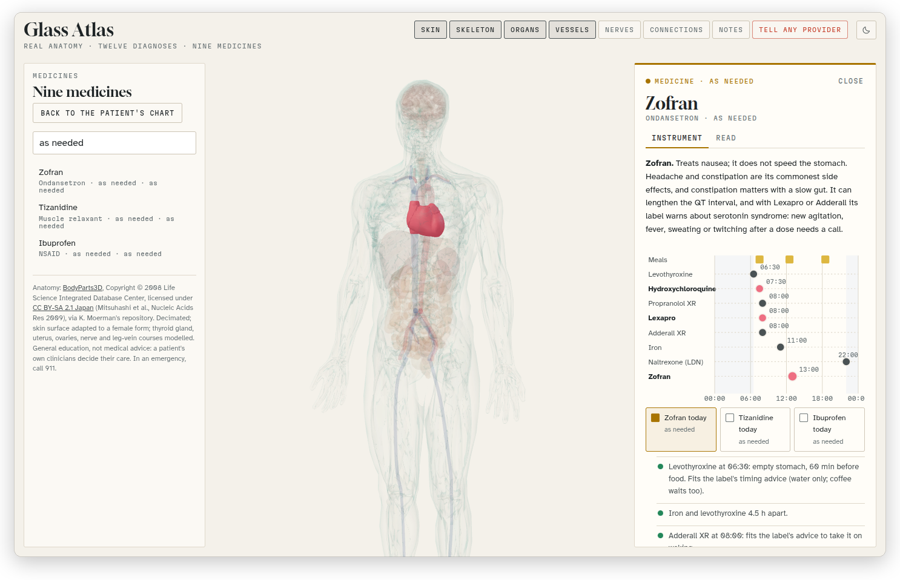
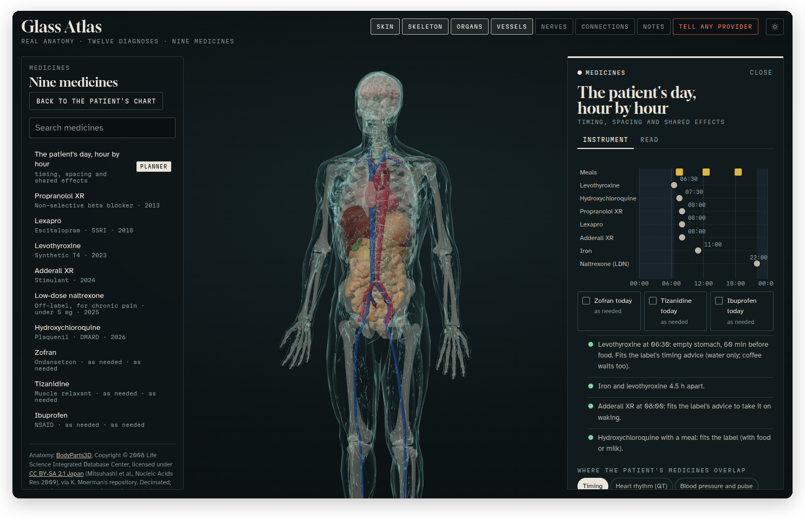

[Glass Atlas docs](README.md) › Using the atlas

# Medicines

The patient takes nine medicines, and a lot of what matters about them is how they get along: which ones need to be hours apart, which ones pull the heart rate in opposite directions, which ones add up. The medicines part of the atlas is built around that, with a page for each medicine and a planner for the whole day.

*The list searched for "as needed", and Zofran open beside it, with the heart lit for the medicines that lengthen the QT interval together.*

## The list

Press **Medicines (9)** at the bottom of the case, and the left panel turns into the list: Propranolol XR, Lexapro, Levothyroxine, Adderall XR, Low-dose naltrexone, Hydroxychloroquine, Zofran, Tizanidine and Ibuprofen, each with what kind of medicine it is. **Back to the patient's chart** takes you back to the conditions.

The "Search medicines" box filters the list as you type, by the name or by the kind, so "SSRI", "beta blocker" or "as needed" all work. **Escape** clears it.

## One medicine

Click a medicine and the drawer opens with two tabs. **Instrument** is the planner, with that medicine picked out and the body lit where it acts. **Read** says what it does in plain words, with a red **For any provider** box where something matters in an emergency, the condition it treats (click it to go there), and the sources. A medicine also shows up as a link at the bottom of the condition it treats.

## The planner

*The patient's day, hour by hour: the meals along the top, a dot for each medicine, the as-needed ones to tick, and the checks underneath.*

The first row of the list, **The patient's day, hour by hour**, opens the planner for all of them together. It's a 24-hour chart: the meals along the top, and a dot for each medicine at the time it's taken. Drag the dots to try a different schedule, and the checks underneath update as you go, in green when a timing fits the label's advice and in red or amber when it doesn't. For example, levothyroxine wants an empty stomach 30 to 60 minutes before food, iron and levothyroxine need four hours apart, and hydroxychloroquine goes with a meal.

The three as-needed medicines (Zofran, Tizanidine and Ibuprofen) are off until you tick them for "today", and then they get a row and their own checks.

Under the checks, "Where the patient's medicines overlap" has a button for each way they add up: **Timing**, **Heart rhythm (QT)**, **Blood pressure and pulse**, **Seizure threshold**, **Pain relief in an emergency**, **Stomach and absorption** and **Serotonin**. Each one lights up the part of the body involved, picks out the medicines that share it, and says in a paragraph what to watch for.

The times are a starting template, not a real schedule, and the planner isn't a dosing plan. The spacing rules come from the medicines' labels, and the sources are on the **Read** tab.

Next: [Connections, the day and the tour](connections-day-tour.md) →
