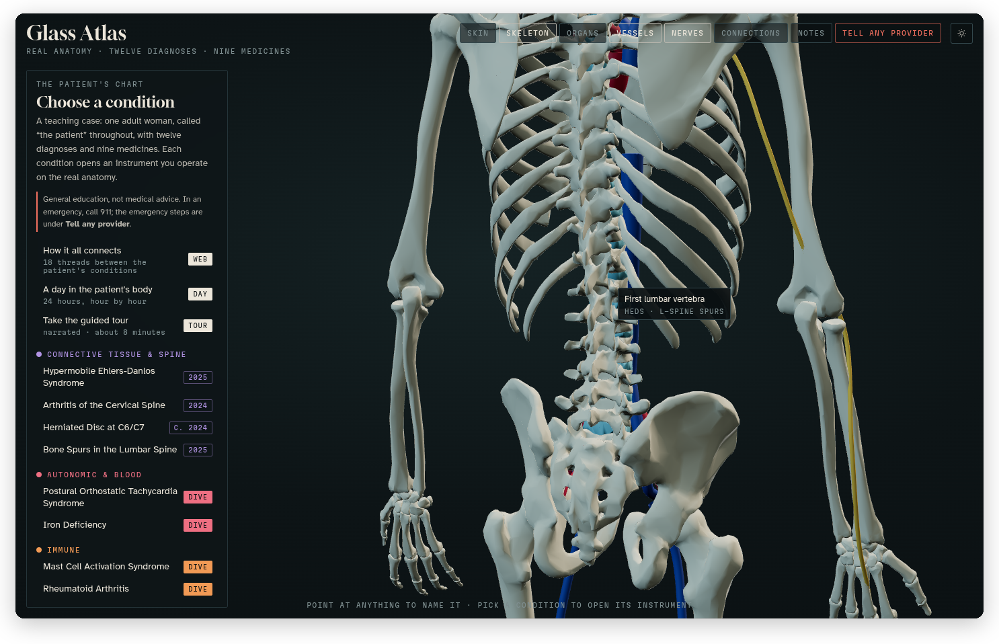
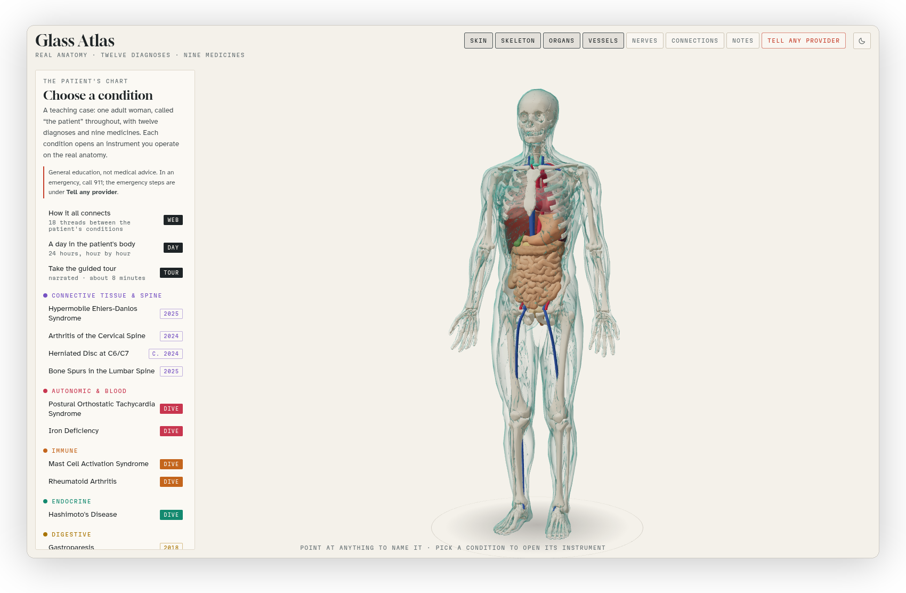

[Glass Atlas docs](README.md) › Using the atlas

# The 3D body

The body in the middle of the screen is the atlas itself. It's built from real anatomical models, the bones, organs, vessels, nerves and skin of the BodyParts3D research database, so what you turn and zoom is the actual shape of a vertebra or a stomach, not a drawing of one.

*The skin and organs turned off and the nerves turned on, seen from behind, with the first lumbar vertebra named under the pointer and the two conditions that involve it.*

## Moving around

Drag to turn the body, and scroll (or pinch, on a phone or a trackpad) to zoom in and out. It always turns around its own middle, so you can't lose it off the side of the screen. When you open a condition, the camera flies to the part that matters by itself, and **Close** on the drawer brings you back to the whole body.

## Naming anything

Point at any structure and its name appears beside the pointer, with the conditions in the case that involve it underneath, like "hEDS · L-spine spurs" for the first lumbar vertebra. On a phone, tap the structure and the name stays for a few seconds. A part marked "Modelled" isn't in the BodyParts3D database and was modelled for the atlas: the thyroid gland, the uterus and ovaries, and the courses of some nerves and leg veins. The skin surface was also adapted to a female form.

## The layers

The buttons along the top turn each layer on and off: **Skin**, **Skeleton**, **Organs** and **Vessels** start on, and **Nerves** starts off. Turning the skin and organs off is the quickest way to see the skeleton, and the nerves are easiest to follow with the skin off too. While an instrument is open it fades the layers it doesn't need and lights up the parts it's about, and the buttons still work on top of that, except that the lit parts always stay visible.

## Light and dark

The sun and moon button at the top right switches between the dark mode and the light mode. Until you press it, the atlas follows your system's setting, and once you pick one it remembers it in your browser.

The dark mode is the original look, a specimen in a dark glass case. The light mode is the same specimen in daylight, on paper. Everything has both, including the drawings in the instruments and the dives, and in light mode the microscope switches from darkfield to brightfield, the way a real one does, while the stained slides keep their real stain colours.

*The home view in light mode.*

Next: [The case and its instruments](the-case.md) →
