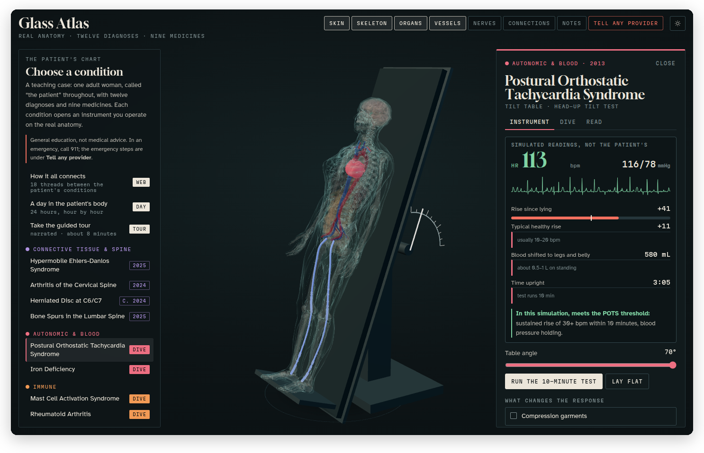
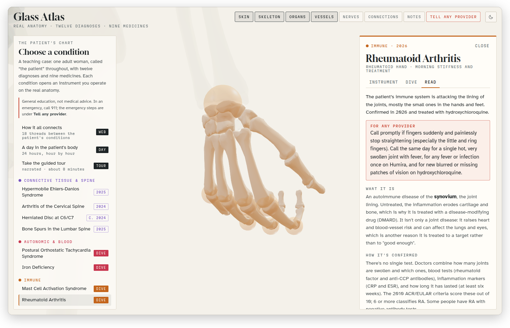
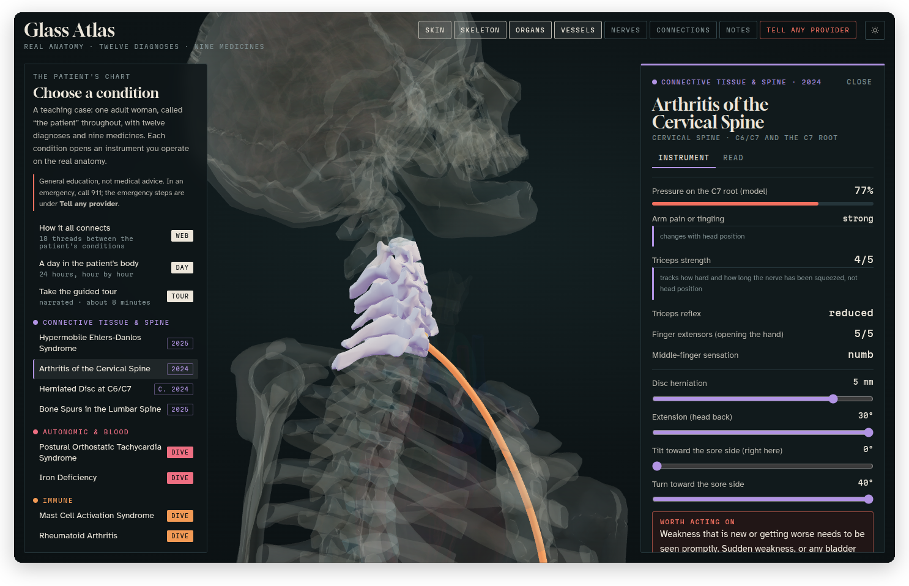
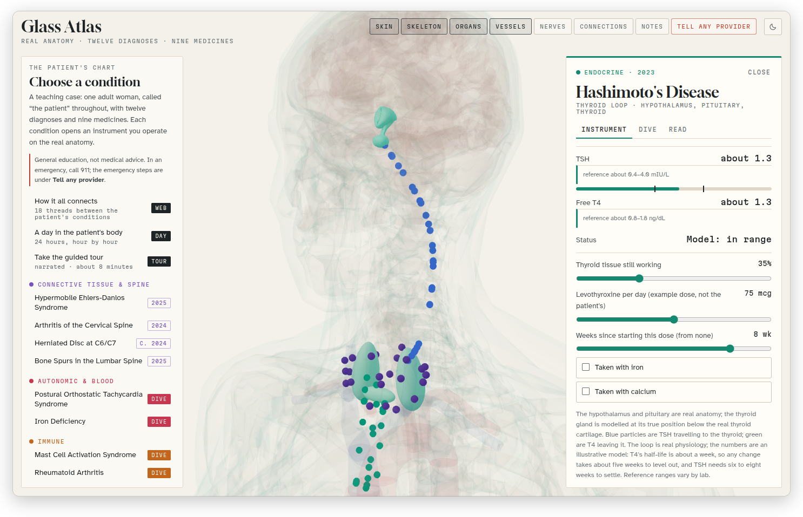

[Glass Atlas docs](README.md) › Using the atlas

# The case and its instruments

The panel on the left is the case. It's a teaching case: one adult woman, called "the patient" throughout, with twelve diagnoses, one more that's suspected, and nine medicines. The conditions are grouped by body system, each in its own colour, and every one of them opens something you can operate.

*Postural Orthostatic Tachycardia Syndrome on the tilt table, three minutes into the test: the heart rate up 41, and more than half a litre of blood shifted to the legs and belly.*

## The panel

At the top are three ways into the whole case: **How it all connects** (the web of links between the conditions), **A day in the patient's body** (24 hours, hour by hour) and **Take the guided tour** (narrated, about eight minutes). They're described in [Connections, the day and the tour](connections-day-tour.md).

Under them are the conditions, by system:

- **Connective tissue & spine:** Hypermobile Ehlers-Danlos Syndrome, Arthritis of the Cervical Spine, Herniated Disc at C6/C7, Bone Spurs in the Lumbar Spine
- **Autonomic & blood:** Postural Orthostatic Tachycardia Syndrome (POTS), Iron Deficiency
- **Immune:** Mast Cell Activation Syndrome, Rheumatoid Arthritis
- **Endocrine:** Hashimoto's Disease
- **Digestive:** Gastroparesis
- **Brain & nerves:** History of Encephalitis, with seizures
- **Reproductive:** Low-Grade Squamous Intraepithelial Lesion (LSIL), and Endometriosis, which is marked "Suspected"

A condition with a **Dive** badge has a microscope dive as well (see [The dives](dives.md)). At the bottom are **Medicines (9)** and **Sources and review**.

## A condition's drawer

Click a condition and the drawer opens on the right, the camera flies to the part of the body it's about, and those parts light up in the condition's colour. The drawer has two or three tabs:

- **Instrument** opens first. It's the hands-on part, described below.
- **Dive**, on the five conditions that have one, says what the dive covers, level by level, and has **Start the dive**.
- **Read** is the reading: one plain sentence first, then "What it is" and a few short sections that differ by condition (how it's confirmed, what helps, what usually happens), with a red **For any provider** box where something matters in an emergency. At the end it lists the structures **Lit on the model**, the medicines that treat it (click one to open it), and the sources.

*Rheumatoid arthritis, on the Read tab in light mode: the plain sentence, the For any provider box, and "What it is".*

Every "Sources:" line in the app is clickable, and it opens the full list with that source highlighted.

## The instruments

Each instrument is a small model of one condition that you operate with sliders and switches, while the body beside it moves and lights up. The numbers are labelled where they're simulated or an example, and none of them are the patient's own readings.

| Condition | Instrument | What you do |
|---|---|---|
| POTS | **Tilt table** | Tilt the table, or press **Run the 10-minute test**, and watch the heart rate and blood pressure, the rise since lying down, and how much blood shifts to the legs and belly. Then try compression garments, fluid and salt, propranolol, or iron deficiency on top. |
| Hypermobile Ehlers-Danlos | **Beighton bench** | Bend the little fingers, thumbs, elbows and knees on the real skeleton, and the palms to the floor, and score the nine points. |
| Mast Cell Activation | **Mast cell bench** | Add triggers until "the bucket" overflows and the skin, gut, airways, heart and brain flare, try the H1 and H2 blockers and cromolyn, and time the tryptase blood test. |
| Hashimoto's | **Thyroid loop** | Set how much thyroid is still working and the levothyroxine dose, and watch TSH and free T4 settle over the weeks, or not, if it's taken with iron or calcium. |
| Encephalitis, with seizures | **Seizure threshold** | See what pushes the threshold down on a given day (short sleep, fever, stress, drinking, skipped meals), with the label cautions of the patient's medicines. |
| Iron deficiency | **Iron ledger** | Follow ferritin and haemoglobin over a year from a starting point and a monthly blood loss you choose, and see when the heart starts to work harder. |
| Gastroparesis | **Gastric emptying** | Play the four-hour scan of a meal leaving the stomach, against the healthy curve, for each grade, with a pill swallowed with the meal. |
| Cervical arthritis, C6/C7 disc | **Cervical spine** | Set the disc herniation, tip the head back, tilt and turn it toward the sore side, try Spurling's test, and follow the C7 nerve to see where it's felt and what weakens. |
| Lumbar bone spurs | **Lumbar openings** | Grow the spurs and lose disc height at L4/L5 and L5/S1, bend and lean, and see how much opening is left for the nerve root. |
| LSIL | **Cervix** | Look through the colposcope with no stain, vinegar and iodine, and follow the usual courses over the months of follow-up. |
| Rheumatoid arthritis | **Rheumatoid hand** | Try to open the hand as the minutes since waking pass, add months of hydroxychloroquine, a steroid bridge or the next step, and see the trigger finger. |
| Endometriosis | **Endometriosis map** | Choose where lesions might be, since it's suspected and not confirmed, and play a cycle to see how each site changes the pain through the month. |

*The cervical spine: a 5 mm disc herniation, the head tipped back and turned, and the readouts for the C7 root.*

*The thyroid loop in light mode: the hypothalamus, the pituitary and the thyroid on the body, and TSH and free T4 in the drawer.*

One more instrument, the **Medicines bench**, is the planner for the patient's whole day, and it's in [Medicines](medicines.md).

## Opening a condition from a link

Add the condition's short name to the end of the address and it opens straight away: `#pots`, `#heds`, `#mcas`, `#hashi`, `#enceph`, `#iron`, `#gastro`, `#carth`, `#c67`, `#lspurs`, `#lsil`, `#ra` or `#endo`. `#sources` opens the sources. This way, instead of telling someone where to click, you can send them the exact screen.

Next: [The dives](dives.md) →
