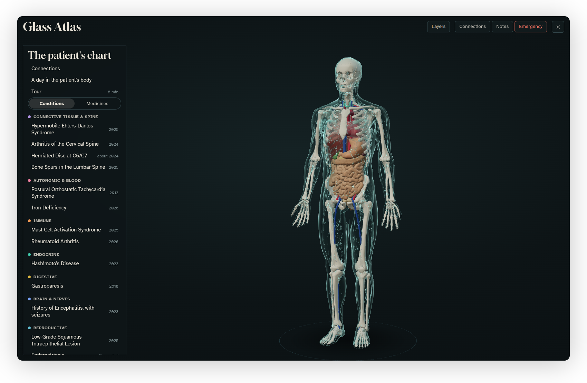
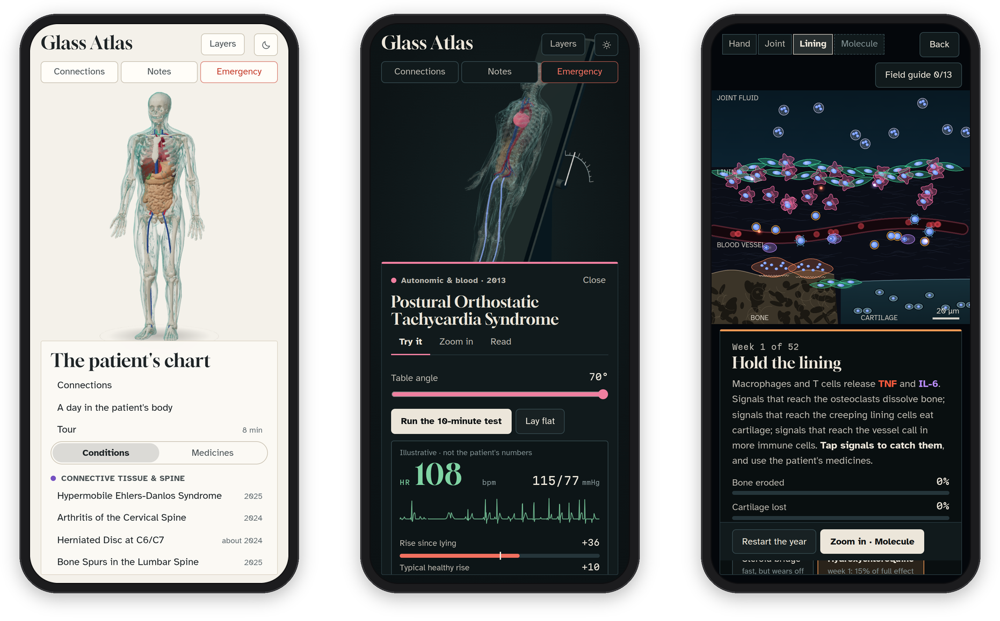

[Glass Atlas docs](README.md) › Getting started

# What is Glass Atlas?

Glass Atlas is an interactive 3D atlas of real human anatomy, built around ONE teaching case: an adult woman, called "the patient" throughout, with twelve diagnoses and eleven medicines. It runs in the browser, on a computer or a phone, in a dark mode and a light mode, and it needs nothing installed.

*The home view: the body in the middle, the patient's chart on the left, and the Layers button and the other views along the top.*

## What it does

Most anatomy apps show you a body, and most case studies are a page of text. Glass Atlas puts the two together. The body in the middle is made from real anatomical models (bones, organs, vessels and nerves from the BodyParts3D research database), and you can turn it, zoom in and point at anything to have it named.

On the left is the patient's chart. Every condition the patient has opens on the right, and its first tab, **Try it**, is an "instrument", something you operate on the anatomy instead of reading about it: a tilt table that stands the body up and shows the heart rate climbing, a hand that opens and closes as the morning stiffness wears off, a neck you tip back until the nerve gets pinched. Each condition also has a short reading on its **Read** tab, with the parts it involves lit up on the body and the sources the text comes from.

Five of the conditions go further, with a "dive" on their **Zoom in** tab: a microscope that zooms from the body down into the tissue, then the cells, and then the molecules, with a small game at one of the levels and a field guide that fills up as you tap things. Each of the eleven medicines has a dive too, which follows it to where it works. Around all of it there's the medicines with a schedule for the whole day, a web of how the conditions connect, a day in the patient's body hour by hour, a narrated tour of about eight minutes, an emergency card, and 260 sources.

Basically, instead of reading that propranolol takes the edge off a racing heart, you put the body on the tilt table, add the medicine, and watch what happens.

It's general education, not medical advice. The case is a teaching case, the models and games are labelled as illustrative where they are, and in real care a patient's own clinicians decide.

## What's on the screen

| Where | What it is | See |
|---|---|---|
| The middle | The body, which you turn, zoom and point at | [The 3D body](the-body.md) |
| The top | **Layers** (the switches for Skin, Skeleton, Organs, Vessels and Nerves), **Connections**, **Notes**, the red **Emergency**, and the sun and moon button | [The 3D body](the-body.md) |
| The left | The patient's chart: Connections, the day and the tour, then a **Conditions** or **Medicines** list, and the sources | [The case and its instruments](the-case.md) |
| The right | The drawer, where a condition's **Try it**, **Zoom in** and **Read** tabs open | [The case and its instruments](the-case.md), [The dives](dives.md) |

## What works where

| | Computer | Phone |
|---|---|---|
| The body | Drag to turn, scroll to zoom, point to name | Drag to turn, pinch to zoom, tap to name |
| The patient's chart | A panel on the left | A panel along the bottom |
| Connections, Notes, Emergency | In the top bar | In a row of their own under the title |
| A condition's tabs | A drawer on the right, beside the body | A drawer that slides up from the bottom, with the body above it |
| The dives | Full screen | Full screen |
| Going back | **Close**, or Esc | **Close**, or the phone's Back gesture |
| Light and dark | Follows the system until you pick one | Follows the system until you pick one |

A phone held sideways keeps the side-by-side panels, the way a computer shows them, and on a touch screen the buttons are big enough for a finger.

It needs a browser with WebGL, which every current browser has. Everything it uses comes with the page, so once it has loaded it keeps working without a connection, and the few things it remembers (your theme, your notes and your field guide) stay in your own browser.

## Who it's for

Anyone who's learning how the body works and how conditions affect each other: students in nursing, medicine and the other health sciences, people who like anatomy, and anyone who'd rather move a slider than read a paragraph. You don't need to know any medicine to start, since every condition opens with a plain sentence of what it is and the tour walks you through the whole case.

## Next step

The quickest way in is the tour: press **Tour** in the patient's chart on the left and let it run. If you'd rather explore by yourself, start with [The 3D body](the-body.md) and then open any condition.

Next: [The 3D body](the-body.md) →
